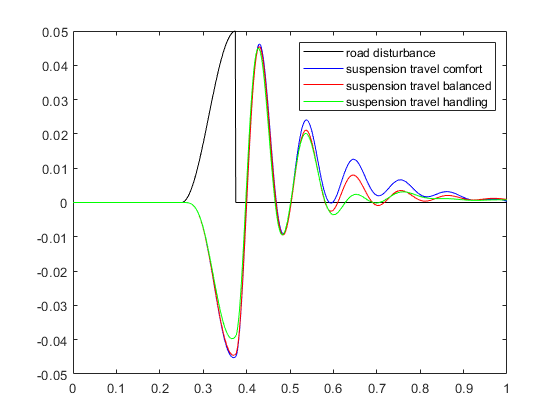
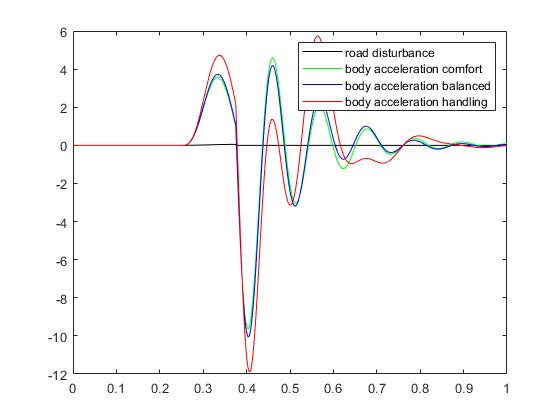

# H∞ Control of a Quarter-Car Active Suspension

A MATLAB/Simulink coursework project studying the trade-off between passenger comfort and suspension handling through weighted H∞ controller design.

The project builds a quarter-car state-space model, synthesizes three controllers with different performance weights, and compares their frequency-domain and time-domain responses. It also defines a dynamic actuator-uncertainty model.

**Authors:** Yiwen Sun and Bo Wang. The accompanying [assignment](PW_Quarter_Car_Suspension.pdf) identifies the MathWorks active-suspension example as its source material.

## Project Scope

The supplied implementation covers:

- four-state modeling of a two-degree-of-freedom quarter-car suspension;
- open-loop frequency-response analysis;
- construction of a weighted generalized plant in Simulink;
- H∞ synthesis for comfort, balanced, and handling-oriented objectives;
- analytical closed-loop models and road-disturbance simulations;
- multiplicative actuator-uncertainty modeling and visualization.

The source includes a section titled `Mu synthesis`, but its implemented content defines and plots actuator uncertainty. It contains no `musyn` or `dksyn` controller-synthesis call. The supplied Simulink models continue to reference the nominal actuator `Act`.

## Archived Results

The following figures are included in the original project submission. They illustrate the three nominal H∞ designs described in the report.

**Suspension-deflection response to the road disturbance:**



**Body-acceleration response:**



Use each figure's legend: the color assignments differ between plots. The black road-displacement trace is a reference input; its units differ from body acceleration in the second figure.

The report and source comments record these weighted closed-loop performance levels:

| Controller | Objective | β | Reported γ |
| --- | --- | ---: | ---: |
| `K1` | Comfort | 0.01 | 0.9410 |
| `K2` | Balanced | 0.50 | 0.6724 |
| `K3` | Handling | 0.99 | 0.8877 |

These γ values belong to differently weighted design problems. Their comparison should be considered together with the physical output responses and selected objectives. They are historical project results, not new synthesis results from the documentation review.

## Files

| File or directory | Purpose |
| --- | --- |
| `Control_design_ok.m` | Main script: define the plant and weights, synthesize controllers, build closed-loop transfer functions, and generate comparisons. |
| `QCS_Sim.mdl` | Generalized plant used by `linmod` before H∞ synthesis. |
| `QCS_Closed_Loop_Sim.mdl` | Closed-loop simulation containing the three controller branches and manual switches. |
| `TP_Robuste.pdf` | Twelve-page French coursework report and original results. |
| `PW_Quarter_Car_Suspension.pdf` | Three-page assignment and model/design specifications. |
| `pictures/1.png`–`pictures/8.png` | Archived frequency- and time-response plots. |
| `1.png` | Additional plot retained at the project root. |
| `slprj/`, `*.slxc` | Generated Simulink cache files supplied with the archive. |

## Quarter-Car Model

The plant represents the sprung vehicle-body mass and the unsprung wheel-assembly mass, coupled through a suspension spring and damper. Tire compliance is represented by a second spring.

| Parameter | Meaning | Value |
| --- | --- | ---: |
| `ms` | Sprung body mass | 300 kg |
| `mus` | Unsprung wheel mass | 60 kg |
| `bs` | Suspension damping | 1000 N·s/m |
| `ks` | Suspension stiffness | 16000 N/m |
| `kt` | Tire stiffness | 190000 N/m |

The four states, two inputs, and three outputs are:

```text
states  = [body displacement, body velocity, wheel displacement, wheel velocity]
inputs  = [road displacement r, active suspension force fs]
outputs = [body displacement xs, suspension deflection xs - xus, body acceleration]
```

Displacements are expressed in meters, and body acceleration in m/s². The force input `fs` is in **kilonewtons**: the state-space matrices include a factor of `1000` for conversion to newtons.

The actuator-to-suspension-deflection and actuator-to-body-acceleration channels have imaginary-axis zeros near **23.0 rad/s** and **56.3 rad/s**, respectively. These constrain achievable disturbance rejection and should be distinguished from the plant poles.

## Controller Design

The nominal actuator is a first-order model:

```text
Act(s) = 1 / (s/60 + 1)
```

The script defines constant road and sensor-noise weights:

```matlab
Wroad = ss(0.07);
Wd2   = ss(0.01);
Wd3   = ss(0.5);
```

The active control-effort weight and performance targets are:

```text
Wact(s) = 0.8 (s + 50) / (s + 500)
G_HT(s) = 0.04 (s/8 + 1) / (s/80 + 1)
G_CT(s) = 0.4 (s/0.45 + 1) / (s/150 + 1)
```

For each choice of β, the performance weights are:

```text
Wsd = β / G_HT
Wab = (1 - β) / G_CT
```

A smaller β emphasizes body-acceleration attenuation for comfort. A larger β emphasizes suspension-deflection attenuation under the project's handling objective.

`QCS_Sim.mdl` combines the plant, actuator, and weights. Its external inputs are `d1`, `d2`, `d3`, and `u`; its outputs are `e1`, `e2`, `e3`, `y1`, and `y2`. The script linearizes it and synthesizes a controller for each weighting configuration:

```matlab
[A1, B1, C1, D1] = linmod('QCS_Sim');
P1 = ss(A1, B1, C1, D1);
[K1, Scl1, gam1] = hinfsyn(P1, 2, 1);
```

Each controller receives two measurements—suspension deflection and body acceleration—and returns one actuator command.

The uncertainty section constructs:

```matlab
Wunc = makeweight(0.40, 15, 3);
unc = ultidyn('unc', [1 1], 'SampleStateDim', 5);
Act_uncertain = Act * (1 + Wunc * unc);
```

This adds an actuator-uncertainty representation for study. Connecting that uncertain actuator to the closed loop and performing μ-synthesis are additional steps beyond the current archived implementation.

## Requirements

The MATLAB workflow requires:

- **MATLAB**;
- **Simulink**, including support for the supplied `.mdl` models and `linmod`;
- **Control System Toolbox**, used for LTI models, frequency responses, time responses, and the models' LTI System blocks;
- **Robust Control Toolbox**, used for `hinfsyn`, `makeweight`, and `ultidyn`.

The models use MATLAB base-workspace variables created by `Control_design_ok.m`. Keep the script and both models in the same working directory.

## Running the Project

In MATLAB, open the project directory and inspect the available toolboxes and functions:

```matlab
cd('path/to/rendu_robust-main');
ver
which hinfsyn
which linmod
```

Run the main script:

```matlab
run('Control_design_ok.m');
```

The script starts with `clear`, `close all`, and `clc`, then creates the plant, weighting functions, controllers, responses, and figures in the MATLAB workspace.

Expected workspace results include `qcar`, `K1`–`K3`, `gam1`–`gam3`, the `Gcl...` closed-loop models, the `sd_...` and `xsddot_...` response arrays, and `Act_uncertain`.

| Figures | Content |
| --- | --- |
| 1–2 | Open-loop road/actuator effects on body acceleration and suspension deflection. |
| 3 | Weighted passive responses against handling and comfort targets. |
| 4–6 | Passive and nominal closed-loop frequency responses. |
| 7–8 | Suspension-deflection and body-acceleration time responses. |
| 9 | Uncertain actuator and nominal actuator comparison. |
| 111–112 | Outputs collected from the separate Simulink simulation runs; account for the manual-switch behavior below. |

After workspace initialization, inspect either model with:

```matlab
open_system('QCS_Sim');
open_system('QCS_Closed_Loop_Sim');
```

The road-input calculation uses a 1 ms sampling interval and a time vector from 0 to 1 second. The cosine expression is assigned only to MATLAB samples `250:375`, producing a windowed disturbance with a peak close to 0.05 m and an abrupt return to zero at the end of the selected window.

## Reproduction Notes

Several details in the archive affect interpretation and reproduction:

- **Controller selection:** the script assigns `Select = 1`, `2`, and `3` before successive Simulink runs. The supplied closed-loop model contains two Manual Switch blocks and no reference to `Select`. Those assignments therefore provide no automatic controller selection in the archived model. Set and verify the active switch branch for each run, or implement a connected selector before comparing the `sd_simC/B/H` and `xsddot_simC/B/H` results.
- **Uncertainty connection:** both models use `Act`. Creating `Act_uncertain` in the workspace alone does not change the simulated actuator or establish robust performance over the uncertainty set.
- **Simulation duration:** the script's `lsim` responses use 0–1 s, while `QCS_Closed_Loop_Sim.mdl` has a 3 s stop time. Align the time windows when comparing outputs.
- **Balanced weight:** the active code uses `β = 0.5`; a sentence in the report mentions `0.05`.
- **Historical plots:** the supplied figures preserve their original labels and formatting. The road reference and acceleration trace have different physical units when drawn on the same axes.

## Verification During Documentation Review

The MATLAB script and Simulink block references were inspected without modifying the original project files. An independent NumPy/SciPy reconstruction of the passive plant checked:

- state-space matrix dimensions and stable passive-plant poles;
- full actuator controllability and output observability, both of rank 4;
- consistent DC gains and the actuator-channel imaginary-axis zeros;
- a finite passive response to the source script's 1,001-sample road-input sequence.

The two `.mdl` files were also checked for complete brace structure and their workspace-variable references. **MATLAB H∞ synthesis and Simulink simulations were not re-run during this review.** The archived plots and reported γ values remain the evidence for the original controller-design results.

## References and Credits

- **Coursework authors:** Yiwen Sun and Bo Wang, as listed in [the report](TP_Robuste.pdf).
- [Course assignment](PW_Quarter_Car_Suspension.pdf), which credits the MathWorks example as its source.
- [MathWorks: Robust Control of Active Suspension](https://www.mathworks.com/help/robust/gs/active-suspension-control-design.html).
- [MathWorks: `hinfsyn`](https://www.mathworks.com/help/robust/ref/dynamicsystem.hinfsyn.html).
- [MathWorks: `linmod`](https://www.mathworks.com/help/simulink/slref/linmod.html).
